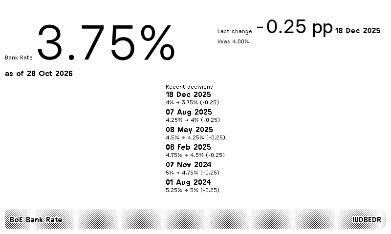

# BoE Bank Rate

TRMNL private plugin for the Bank of England official Bank Rate and recent rate decisions.



## Data source

Rates come from the [Bank of England](https://www.bankofengland.co.uk/) Interactive Database (IADB), daily series **IUDBEDR** (official Bank Rate):

```
https://www.bankofengland.co.uk/boeapps/iadb/fromshowcolumns.asp?csv.x=yes&Datefrom=01/Jan/2020&Dateto=now&SeriesCodes=IUDBEDR&CSVF=TN&UsingCodes=Y&VPD=Y&VFD=N
```

The Bank of England publishes this series. This plugin is an independent recipe and is not affiliated with the Bank of England. The CSV endpoint expects a browser-like `User-Agent`, which is set in `src/settings.yml`.

It shows the current rate, the date of the last change, the previous rate and the move in percentage points, and a short history of decisions. Layouts: full, half horizontal, half vertical, and quadrant. A daily refresh (`1440` minutes) matches the series. TRMNL can poll the CSV directly; `src/transform.py` turns the rows into the fields the layouts use.

## Install

### Import a ZIP into TRMNL

TRMNL **Import new** expects a flat archive: `settings.yml`, the Liquid layouts, and `transform.py` at the top level (no `src/` directory).

```bash
cd src
zip ../boe-bank-rate.zip settings.yml full.liquid half_horizontal.liquid half_vertical.liquid quadrant.liquid transform.py
```

On the Private Plugin page, click **Import new** and upload `boe-bank-rate.zip`. TRMNL creates the plugin and adds it to your playlist.

### Develop or push with trmnlp

This repository is a [trmnlp](https://github.com/usetrmnl/trmnlp) project (`src/` and `.trmnlp.yml`). `.trmnlp.yml` is local preview config and is not uploaded.

Install `trmnlp` (RubyGems `trmnl_preview`, or the Docker wrapper in the trmnlp README), then from this directory:

```bash
trmnlp login
trmnlp serve   # preview at http://localhost:4567
trmnlp push    # upload to your TRMNL account
```

### Optional JSON proxy (Cloudflare Worker)

`worker/` fetches the same Bank of England CSV and returns the JSON shape the layouts expect. Deploy it with [Wrangler](https://developers.cloudflare.com/workers/wrangler/), then set `polling_url` to the Worker URL. You can drop the serverless transform if you poll the Worker instead of the CSV.

```bash
cd worker
npx wrangler login
npx wrangler deploy
```

## License

[MIT](LICENSE) © 2026 Alex Baldry
